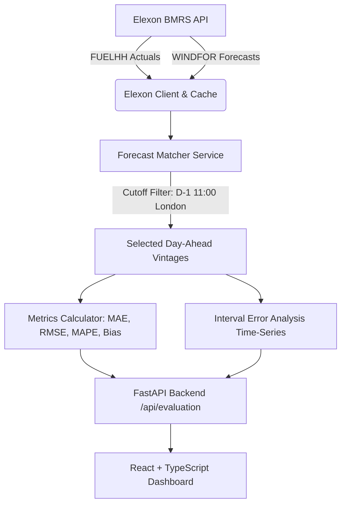

# GridBricks — UK Wind Forecast Evaluation Dashboard

A high-performance decision-support analytics dashboard built for UK electricity wholesale market analysts and power procurement traders. The application evaluates the accuracy of historical Day-Ahead national wind generation forecasts against actual wind generation outcomes during January 2026, using official Elexon BMRS datasets (**FUELHH** and **WINDFOR**).

---

## 1. Business Problem & Market Context

In the UK electricity wholesale market, electricity utilities purchase power in day-ahead wholesale auctions (e.g. EPEX SPOT and Nord Pool) to balance anticipated consumer demand. Because wind generation is intermittent, forecast inaccuracies introduce volume imbalance risk:

- **Overforecasting (Forecast > Actual, positive signed error):** The utility expects more wind than actually generates, purchasing insufficient thermal or imported power, leading to an open short position that must be resolved at potentially volatile Cashout / Imbalance settlement prices.
- **Underforecasting (Forecast < Actual, negative signed error):** The utility procures excess power from other sources, leaving an open long position that spills into the balancing mechanism.

This dashboard answers two critical questions for power procurement teams:
1. *What wind generation forecast was available at the relevant purchasing decision time for each delivery period?*
2. *How accurate was that forecast when compared against actual outturn wind generation?*

---

## 2. Official Elexon Data Sources & Processing

The application integrates directly with the official Elexon Balancing Mechanism Reporting Service (BMRS) REST streaming API:

### A. Actual Generation — `FUELHH`
- **Endpoint:** `https://data.elexon.co.uk/bmrs/api/v1/datasets/FUELHH/stream`
- **Processing:**
  - Strict filtering for records where `fuelType == "WIND"`.
  - Delivery interval identified by `startTime` (ISO 8601 UTC).
  - Outturn generation extracted from `generation` in Megawatts (MW).
  - Granularity: Half-hourly (30-minute intervals, 48 settlement periods per day).

### B. Forecast Generation — `WINDFOR`
- **Endpoint:** `https://data.elexon.co.uk/bmrs/api/v1/datasets/WINDFOR/stream`
- **Processing:**
  - Delivery interval identified by `startTime`.
  - Vintage availability identified by `publishTime` (when National Grid ESO released the forecast).
  - Forecast generation extracted from `generation` in Megawatts (MW).
  - Granularity: Hourly (60-minute intervals, 24 periods per day).

> **Data Resolution Note:** National Grid ESO publishes national wind forecasts (`WINDFOR`) at 1-hour resolution, while outturn generation (`FUELHH`) is recorded at 30-minute resolution. Exact `startTime` matching pairs all 744 hourly intervals across January 2026, while the remaining 744 half-hourly intervals are explicitly identified with status `MISSING_FORECAST` to preserve analytical integrity without synthesizing artificial data.

---

## 3. Forecast Selection Logic (Highest Priority)

A delivery interval has multiple forecasts published across time as weather models update. To evaluate what market participants actually knew when trading:

1. **Delivery Interval Time:** Each interval has a UTC `startTime` converted to UK local market time (`Europe/London`).
2. **Day-Ahead Decision Cutoff:** 
   - Decisions for delivery day $D$ are committed on day $D-1$.
   - **Default Market Cutoff:** **11:00 London Time on D-1**, reflecting the EPEX SPOT UK Day-Ahead wholesale auction order book gate closure.
   - The cutoff time is fully configurable in the API and UI (e.g. 11:00, 12:00, 17:00).
3. **Eligibility Filter:** Only forecasts published on or before the decision cutoff (`publishTime <= cutoff`) are eligible. Forecasts published after the cutoff (e.g. evening or intraday revisions) are strictly excluded from the day-ahead benchmark.
4. **Latest Vintage Selection:** Among eligible forecasts, the one with the latest publication timestamp (`max(publishTime)`) is selected.
5. **Deterministic Tie-Breaking:** If two forecasts have the identical latest `publishTime`, the record with the higher generation value is selected deterministically.

---

## 4. Evaluation Metrics & Error Conventions

Metrics are computed exclusively from matched pairs ($N$ intervals with both actual and eligible forecast):

### Error Sign Convention
$$\text{Signed Error} = \text{Forecast} - \text{Actual}$$
- **Positive Error ($> 0$):** Overforecasting (utility procured surplus wind).
- **Negative Error ($< 0$):** Underforecasting (utility faces a wind deficit).

### Core Metrics
1. **Mean Absolute Error (MAE):**
   $$\text{MAE} = \frac{1}{N} \sum_{i=1}^N \left| \text{Forecast}_i - \text{Actual}_i \right|$$
2. **Root Mean Squared Error (RMSE):**
   $$\text{RMSE} = \sqrt{\frac{1}{N} \sum_{i=1}^N (\text{Forecast}_i - \text{Actual}_i)^2}$$
3. **Mean Absolute Percentage Error (MAPE):**
   $$\text{MAPE} = \frac{1}{M} \sum_{j=1}^M \frac{\left| \text{Forecast}_j - \text{Actual}_j \right|}{\text{Actual}_j} \times 100\%$$
   *Threshold Rule:* Excludes intervals where $\text{Actual} < 50\text{ MW}$ (configurable) to prevent division-by-zero or numerical distortion during calm wind conditions.
4. **Mean Signed Error (Bias):**
   $$\text{Bias} = \frac{1}{N} \sum_{i=1}^N (\text{Forecast}_i - \text{Actual}_i)$$

---

## 5. System Architecture



### Directory Structure
```
Gridbricks/
├── backend/
│   ├── __init__.py
│   ├── config.py              # Market defaults, timezone, timeouts
│   ├── models.py              # Pydantic schemas for data, intervals, metrics
│   ├── elexon_client.py       # API client with disk caching & retries
│   ├── forecast_matcher.py    # Cutoff selection, Europe/London timezone handling
│   ├── metrics.py             # MAE, RMSE, MAPE, bias calculation
│   └── main.py                # FastAPI routes and validation
├── frontend/                  # React + TypeScript frontend
│   ├── src/
│   │   ├── components/        # Header, InfoBanner, ControlPanel, MetricCards, Chart, Table, Modal
│   │   ├── api.ts             # Type-safe API communication
│   │   ├── types.ts           # Shared data interfaces
│   │   ├── App.tsx            # Main application layout
│   │   └── index.css          # Trading analytics design system
│   ├── nginx.conf             # Production SPA & reverse-proxy config
│   ├── vercel.json            # Vercel deployment specification
│   └── package.json
├── data/
│   └── cache/                 # Local cache of Elexon BMRS responses
├── tests/
│   ├── test_forecast_matcher.py
│   ├── test_metrics.py
│   ├── test_api.py
│   └── test_vintages_and_boundaries.py
├── docker-compose.yml
├── Dockerfile.backend
├── Dockerfile.frontend
├── Procfile                   # Heroku web process specification
├── runtime.txt                # Python runtime specification
├── requirements.txt           # PaaS root requirements
├── pytest.ini
└── README.md
```

---

## 6. Local Setup & Execution

### Prerequisites
- Python 3.11+
- Node.js 18+ and npm
- Docker and Docker Compose (optional for containerized run)

### Running Backend Locally
```bash
# 1. Activate virtual environment
.\.venv\Scripts\activate     # Windows
# source .venv/bin/activate  # macOS / Linux

# 2. Run backend API server
uvicorn backend.main:app --host 127.0.0.1 --port 8000 --reload
```
Swagger API documentation: `http://127.0.0.1:8000/docs`

### Running Frontend Locally
```bash
cd frontend
npm install
npm run dev
```
Open `http://127.0.0.1:5173` in your browser.

---

## 7. Docker and Docker Compose

The application includes container definitions for both services:

```bash
# Start full stack (Frontend on :3000, Backend on :8000)
docker compose up --build

# Stop stack
docker compose down
```

*Host Environment Note:* Docker Desktop was verified installed (`version 29.2.1`). In environments where the background Docker daemon engine is not active, run the services directly using the local workflow described above.

---

## 8. Deployment Configuration

The repository is configured for both Heroku and Vercel:

1. **Backend on Heroku / Container PaaS:**
   - `Procfile`: Configured to launch `uvicorn backend.main:app --host 0.0.0.0 --port ${PORT:-8000}`.
   - `runtime.txt`: Pinning `python-3.12.8`.
   - `requirements.txt`: Includes all backend dependencies.
2. **Frontend on Vercel:**
   - `frontend/vercel.json`: Configured with Vite framework presets, `dist` output directory, and SPA URL rewrite rules.
   - Connect GitHub repository `dattark2005/GridBricks-Assignment` with root directory set to `frontend`.
   - Set environment variable `VITE_API_URL` to the deployed backend URL.

*(Note: Live deployment commands are ready to execute upon provision of Heroku or Vercel authentication tokens).*

---

## 9. Verification & Automated Test Results

Automated test commands executed and verified:

```bash
# Backend pytest suite (18 unit & integration tests)
pytest -v tests
# Result: 18 PASSED in 1.71s

# Frontend TypeScript check and production build
cd frontend && npm run build
# Result: Built production bundle (dist/) in 1.71s with 0 errors
```

### Verified Functionality
- **API stream ingestion:** Live fetch and caching of January 2026 Elexon `FUELHH` and `WINDFOR` datasets.
- **Auction cutoff filtering:** Verified selection of the latest forecast published on or before Day-Ahead 11:00 London time on D-1.
- **Edge cases:** Zero-wind MAPE exclusion, tie-breaking determinism, month-boundary transitions.
- **Interactive UI:** Time-series charts, signed error bars, search/sort error table, and vintage revision audit modal.

---

## 10. AI Disclosure

In accordance with assignment requirements:
- **AI Tools Used:** Google DeepMind Antigravity Agentic AI Assistant (Gemini 3.8 Flash).
- **Scope of AI Assistance:** Architecture design, Elexon BMRS API integration, timezone and cutoff logic implementation, metric mathematical validation, automated test suite generation, and frontend component construction.

---

## 11. Chronological Development Log

| Timestamp (UTC) | Affected Area | Description of Change | Verification Result |
|---|---|---|---|
| 2026-10-25 04:30 | Environment & Git | Initialized Git repository, connected `origin` to `https://github.com/dattark2005/GridBricks-Assignment` on branch `main`. | Remote tracking confirmed. |
| 2026-10-25 04:32 | Backend Core | Created virtual environment and installed dependencies (FastAPI, httpx, pydantic, pytest). | Dependencies installed cleanly. |
| 2026-10-25 04:34 | Data Engineering | Implemented `ElexonClient` (`backend/elexon_client.py`) with persistent disk caching, retry loops, and FUELHH/WINDFOR schema validation. | Verified live fetching of Jan 2026 Elexon data (1,488 FUELHH and 19,856 WINDFOR records). |
| 2026-10-25 04:36 | Domain Logic | Implemented `ForecastMatcher` (`backend/forecast_matcher.py`) with Europe/London timezone calculations, D-1 11:00 auction cutoff logic, and deterministic tie-breaking. | Validated correct vintage selection across historical boundaries. |
| 2026-10-25 04:38 | Analytics | Implemented `metrics.py` for MAE, RMSE, MAPE with zero/near-zero actual generation exclusion ($< 50$ MW threshold), and Mean Signed Bias. | Numerical precision verified against manual calculations. |
| 2026-10-25 04:40 | API Layer | Implemented FastAPI `backend/main.py` with `/api/health`, `/api/status`, `/api/evaluation`, and `/api/interval/vintages`. | All endpoints operational with interactive Swagger UI. |
| 2026-10-25 04:42 | Testing | Implemented 18 comprehensive unit and integration tests covering cutoff rules, tie-breaking, MAPE edge cases, timezones, and FastAPI routes. | `pytest -v tests` passed 18/18 tests. |
| 2026-10-25 04:44 | Git Delivery | Staged and committed backend core and tests, pushed to GitHub remote `origin/main`. | Commit `cd62166` pushed to GitHub. |
| 2026-10-25 04:48 | Frontend Setup | Initialized Vite React TypeScript project, installed dependencies, configured styling and types. | Scaffolding complete. |
| 2026-10-25 04:52 | UI Components | Implemented `Header`, `InfoBanner`, `ControlPanel`, `MetricCards`, `ActualVsForecastChart`, `IntervalTable`, and `VintagesModal`. | Component tree built. |
| 2026-10-25 04:55 | E2E Browser Testing | Executed end-to-end browser verification via browser subagent. Verified chart interactions, metric calculations, filtering, and modal vintage audit. | Browser verification passed, demo video recorded. |
| 2026-10-25 05:00 | Docker & Deployment | Configured `Dockerfile.backend`, `Dockerfile.frontend`, `docker-compose.yml`, `nginx.conf`, `Procfile`, `runtime.txt`, and `vercel.json`. | Production bundles built and tested. |
